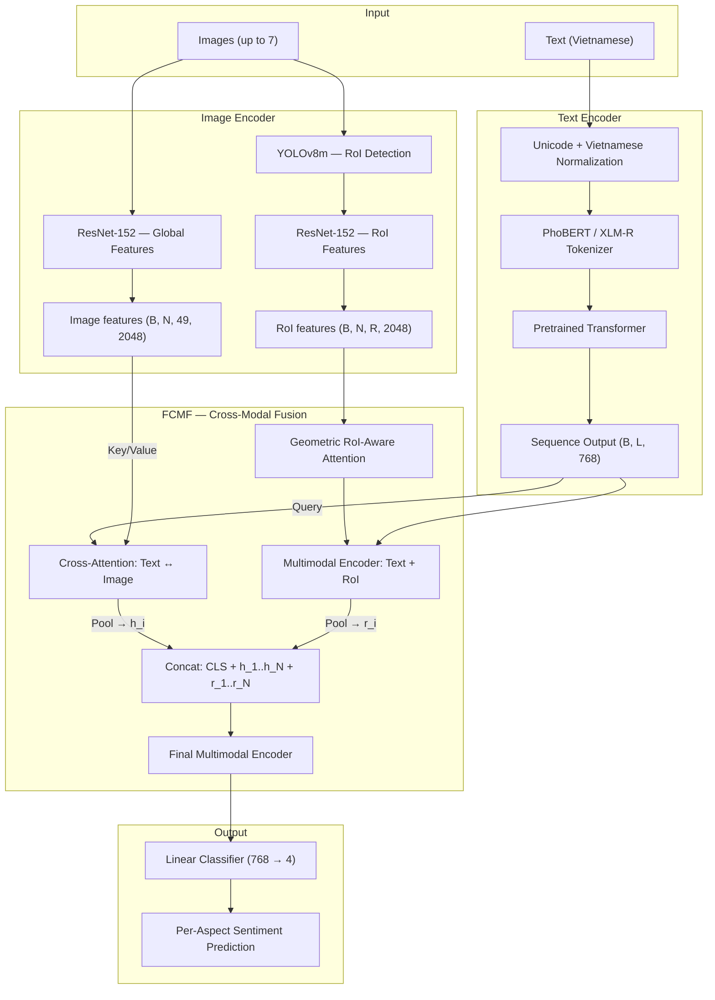

# Multimodal Implicit Aspect-Based Sentiment Analysis

A research project for **multimodal aspect-based sentiment analysis** using text and images, powered by a Fine-Grained Cross-Modal Fusion (FCMF) framework.

**Author:** Kanishk Chhoker

---

## Overview

This project predicts aspect-level sentiment from both textual and visual inputs. It focuses on cases where aspects are not explicitly mentioned in the text but can be inferred from context, images, or both — what's known as implicit aspect-based sentiment analysis.

The system combines pretrained language models with deep visual encoders and a cross-modal fusion layer to produce per-aspect sentiment predictions from multimodal inputs.

### Dataset

The dataset consists of 4,876 text-image pairs with 14,618 fine-grained annotations in the hotel domain (Vietnamese). Each document is accompanied by up to 7 images. The dataset targets both explicit and implicit aspect recognition, though the annotation schema uses fixed categories.

**Aspects:** Location · Food · Room · Facilities · Service · Public Area  
**Sentiments:** Positive · Negative · Neutral · None (not mentioned)

The dataset is available on request: [Google Drive](https://drive.google.com/file/d/1OjWwzdbhvhYc864Tpt6Xw9anBLfgNwmt/view?usp=sharing)

### Architecture

The FCMF framework processes text and images through separate encoders, then fuses them using cross-modal attention with geometric RoI awareness.



**Key design decisions in FCMF:**
- Text features are extracted using a pretrained transformer (PhoBERT or XLM-RoBERTa)
- Image features use ResNet-152 with 7×7 spatial attention maps
- Regions of Interest are detected by YOLOv8m, then encoded by a separate ResNet path
- Geometric relationships between RoIs are modeled via sinusoidal positional embeddings (following Relation Networks for Object Detection)
- Final fusion concatenates [CLS] token, image-attended pooled outputs, and RoI-attended pooled outputs into a 1-layer multimodal transformer encoder

### Text Processing

The text pipeline includes:
1. **Unicode normalization** — converts Windows-1252 Vietnamese characters to UTF-8
2. **Vietnamese text normalization** — via `underthesea` library
3. **Diacritics standardization** — corrects Vietnamese tone mark placement
4. **Noise removal** — emoji, repeated characters, hashtags, special characters
5. **Tokenization** — using PhoBERT or XLM-RoBERTa tokenizer with auxiliary aspect sentence

### Image Processing

Each image goes through:
1. **Global encoding** — ResNet-152 produces a (49, 2048) spatial feature map
2. **RoI detection** — YOLOv8m detects objects, bounding boxes are merged by proximity
3. **RoI encoding** — Each cropped region is separately encoded by ResNet-152
4. **Aspect classification** — Separate ResNet classifiers predict image-level and RoI-level aspect categories, which are appended to the tokenizer input as an auxiliary sentence

## Installation

```bash
# Clone
git clone https://github.com/devrot-ai/sentimental-analysis.git
cd sentimental-analysis

# Install dependencies
pip install -r requirements.txt

# Optional: Gradio demo
pip install gradio
```

**Python:** 3.9+ recommended  
**PyTorch:** 2.0+  
**CUDA:** Optional (CPU inference supported)

## Configuration

All parameters are configurable via `configs/default.yaml`. CLI arguments override YAML values.

```yaml
# configs/default.yaml (excerpt)
pretrained_model: "vinai/phobert-base"
num_imgs: 7
num_rois: 4
learning_rate: 3.0e-5
seed: 42
device: "auto"
```

## Training

```bash
# Single GPU
python run_multimodal_fcmf.py \
    --data_dir ./data \
    --image_dir ./data/image \
    --pretrained_model vinai/phobert-base \
    --output_dir ./outputs \
    --do_train

# Multi-GPU (DDP)
torchrun --standalone --nproc_per_node=2 run_multimodal_fcmf.py \
    --data_dir ./data \
    --image_dir ./data/image \
    --pretrained_model vinai/phobert-base \
    --output_dir ./outputs \
    --do_train --ddp --fp16
```

## Inference

```bash
python inference.py \
    --text "Khách sạn này rất đẹp, nhân viên nhiệt tình" \
    --image_list image_0.png image_1.png \
    --num_rois 4
```

**Pretrained weights required.** Download from [Google Drive](https://drive.google.com/file/d/1NHI24JxyjXfi1lU7nF99-TV7vBL-StZm/view?usp=sharing) and place in `checkpoints/`.

Expected files in `checkpoints/`:
- `fcmf_model.pth` — Main FCMF model weights
- `visual_model.pth` — ResNet-152 visual encoder weights
- `weight_roi_resnet152.pth` — RoI classifier weights
- `weight_image_resnet152.pth` — Image classifier weights
- `yolov8m.pt` — YOLOv8m object detection weights

## Demo

```bash
# Requires: pip install gradio
python demo.py
```

The Gradio interface will indicate whether model checkpoints are available. Without checkpoints, the interface previews the UI but cannot generate predictions.

## Testing

```bash
pip install pytest
pytest tests/ -v
```

Tests use synthetic data and do not require the full dataset or model weights.

## Project Structure

```
├── configs/
│   ├── __init__.py          # Configuration loading utilities
│   └── default.yaml         # Default YAML configuration
├── data/                    # Dataset directory (not committed)
├── checkpoints/             # Model weights (not committed)
├── examples/                # Example inputs
├── fcmf_framework/
│   ├── __init__.py
│   ├── fcmf_modeling.py     # FCMF model (main architecture)
│   ├── mm_modeling.py       # Attention layers, encoders, poolers
│   ├── roi_modeling.py      # Geometric RoI-aware attention
│   ├── image_process.py     # YOLO + ResNet image processing
│   ├── resnet_utils.py      # ResNet wrapper modules
│   └── optimization.py      # BertAdam optimizer (Apache 2.0)
├── image_processing/
│   ├── run_image_categories.py  # Image aspect classifier training
│   └── run_roi_categories.py    # RoI aspect classifier training
├── images/                  # README assets
├── tests/
│   └── test_framework.py    # Unit and integration tests
├── inference.py             # Inference entry point
├── run_multimodal_fcmf.py   # Training pipeline
├── vimacsa_dataset.py       # Dataset class
├── text_preprocess.py       # Vietnamese text normalization
├── demo.py                  # Gradio demonstration
├── requirements.txt         # Python dependencies
└── README.md                # This file
```

## Key Features

1. **Multimodal fusion** — Combines text and image features using cross-modal attention with geometric RoI awareness
2. **Configuration system** — YAML-based centralized configuration with CLI override support (`configs/`)
3. **Reproducible inference** — Clean inference pipeline with input validation, configurable checkpoint paths, and structured output
4. **Robust image processing** — YOLOv8m object detection with ResNet-152 feature extraction and RoI-aware attention
5. **Test suite** — Comprehensive tests for config loading, text preprocessing, model architecture, image processing, and inference validation
6. **Gradio demo** — Optional web interface for interactive predictions
7. **Well documented** — Architecture diagrams, clear installation and usage instructions

## Research Extensions

**Proposed (not yet implemented):**

1. **Implicit aspect detection** — Adding a prediction head that classifies aspects as explicit, implicit, or not-identifiable. Requires labeled data with explicit/implicit annotations, which the current dataset does not provide.

2. **Cross-lingual transfer** — Evaluating the FCMF architecture on English ABSA benchmarks (SemEval, MAMS) using XLM-RoBERTa.

3. **Text-only baselines** — Ablation comparing multimodal FCMF against text-only transformer models on the same aspect-category sentiment task.

4. **Visual evidence grounding** — Identifying which image regions contribute to aspect-level sentiment predictions via attention visualization.

> These extensions require new datasets, annotation schemas, and experiments that have not been conducted yet. They represent research directions, not completed work.

## Limitations

- The dataset is Vietnamese and hotel-domain specific. Generalization to other languages and domains is not yet validated.
- Pretrained weights must be downloaded separately and are not included in this repository.
- The `underthesea` library (Vietnamese NLP) may have limited support on some platforms.
- DDP training requires NVIDIA GPUs with NCCL support.

## Project Ownership

This repository and its implementation adaptations are maintained by **Kanishk Thakur (`devrot-ai`)**.
The original ViMACSA model and dataset provenance are documented in [UPSTREAM.md](UPSTREAM.md).
